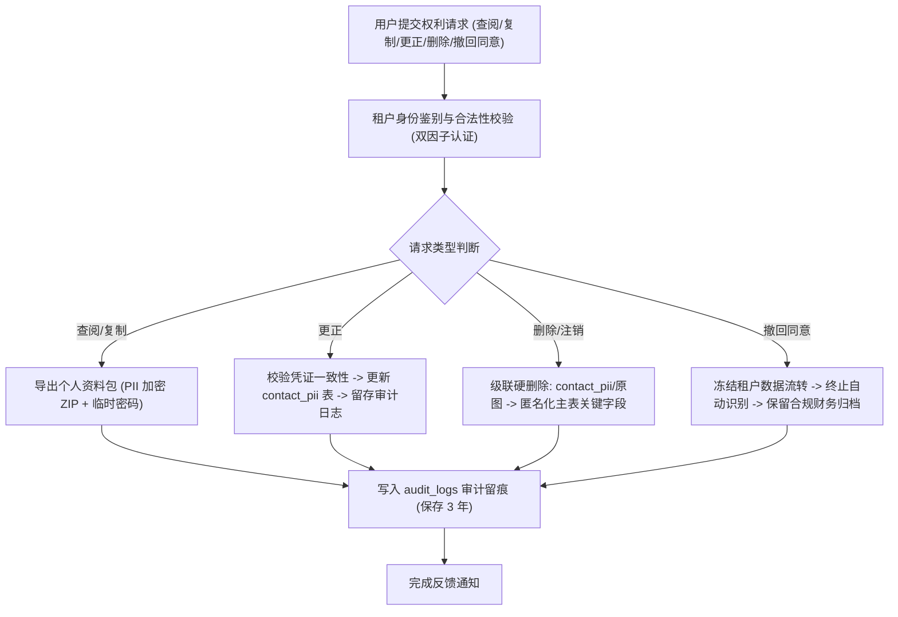
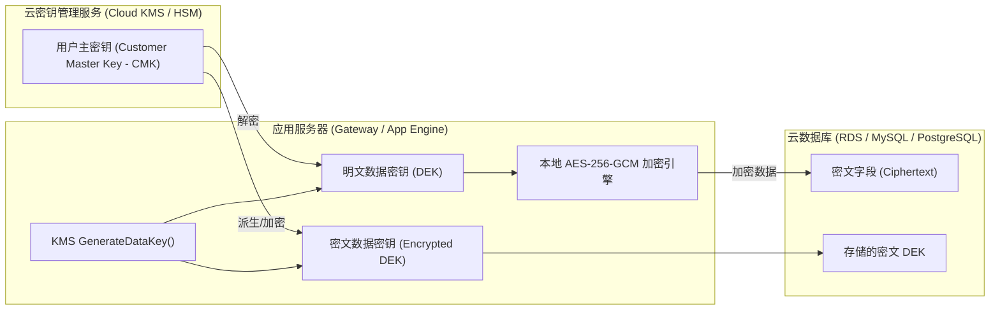

# 合规落地路线图与数据安全规范 (Compliance Roadmap & Data Protection Spec)

- 文档标识: W-CMP-1
- 日期: 2026-09-27 (落地实施 2026-09-28)
- 范围: 票据智能体系统 (Receipt Agent) 个人信息保护、等保三级基线、数据分级分类、加密存储与 AI 合成标注

---

## 1. 法律法规与监管框架适用性分析

本系统定位于企业级餐饮供应链票据自动化处理与财税核算，涉及供应商凭据、收货单、增值税发票等财务及商业敏感数据。系统合规体系须全面遵从以下法律法规：

### 1.1 核心适用法律法规

1. **《中华人民共和国个人信息保护法》(PIPL)**:
   - 适用场景: 票据及签字中出现的经手人姓名、收货人电话、身份证号、银行账号、送货地址等个人信息处理。
   - 核心合规动作: 最小必要收集、明确知情同意、敏感个人信息单独同意、存储期限限制、用户权利响应机制（查阅、复制、更正、删除）。

2. **《中华人民共和国网络安全法》与《网络安全等级保护基本要求》(等保 2.0 / GB/T 22239-2019 等保三级)**:
   - 适用场景: 承载企业核心供应链财务数据的在线交易与凭证存储系统。
   - 核心合规动作: 身份鉴别双因子、访问控制最小授权、安全审计留痕至少 6 个月、入侵防范与网络隔离、数据完整性与保密性保护（国密/AES 加密）。

3. **《中华人民共和国数据安全法》(DSL)**:
   - 适用场景: 数据全生命周期安全管理（收集、存储、使用、加工、传输、提供、公开）。
   - 核心合规动作: 数据分类分级保护制度、重要数据出境安全评估、风险监测与应急处置机制。

4. **《互联网信息服务深度合成管理规定》及《生成式人工智能服务管理暂行办法》**:
   - 适用场景: 引入大语言模型 (LLM) 与视觉语言模型 (VLM) 进行票据自动结构化、字段重组与差异复核。
   - 核心合规动作: 人工智能生成内容显著标识、算法备案、训练数据合法合规性保障、防范合成虚假凭证欺诈。

5. **香港特别行政区《个人资料（私隐）条例》(PDPO)**:
   - 适用场景: 跨境供应链中涉及香港本土餐厅、食材供应商（含港式花码、香港九龙及新界地址、香港电话与转数快 FPS 账号）的处理。
   - 核心合规动作: 数据保障原则（DPP 1-6），保障资料只用于收集目的，防范未经授权存取。

---

## 2. 数据分类分级规范 (L1 - L4) 与数据库字段映射表

系统根据数据遭到泄露、篡改或毁损后对国家安全、公共利益或个人/企业合法权益造成的危害程度，将数据严格划分为四个等级：

- **L1 (公开级 / Public)**: 公开可获取的元数据、通用菜品/品类公共目录、系统对外公开文档与帮助手册。
- **L2 (内部级 / Internal)**: 系统运行指标、匿名化性能指标、模型延迟与吞吐量监控、非敏感的租户通用配置。
- **L3 (敏感级 / Sensitive - 商业敏感)**: 供应商企业名称、采购品项明细与单价、票据流水金额、交易时间、对账日志、商户账册。
- **L4 (极度敏感级 / Restricted - PII 与凭据)**: 经手人身份证号、收货人手机号、银行全量账号、票据手写签名/红章切片原图、API 密钥与身份令牌。

### 2.1 数据库表及字段级分类映射全景表

| 数据库表 | 字段名 | 数据级别 | 敏感类型 | 存储保护措施 | 传输与展示脱敏规范 |
| :--- | :--- | :--- | :--- | :--- | :--- |
| `tenants` | `id` | L1 | 业务标识符 | 明文存储 (索引) | 内部系统直读 |
| `tenants` | `name` | L2 | 企业名称 | 明文存储 | 正常展示 |
| `tenants` | `api_key_hash` | L4 | 鉴权凭据 | PBKDF2/Argon2 散列加盐 | 永不回显，不可逆 |
| `tenants` | `created_at` | L2 | 时间戳 | 明文存储 | 正常展示 |
| `receipts` | `id` | L1 | 内部主键 | 明文存储 (自增主键) | 正常展示 |
| `receipts` | `tenant_id` | L2 | 多租户标识 | 明文存储 (复合索引) | 租户间物理隔离/过滤 |
| `receipts` | `image_path` | L3 | 原始凭证路径 | 相对路径加密散列 | 受限访问控制，需签名 URL |
| `receipts` | `image_hash` | L2 | 完整性校验 | SHA-256 散列 | 内部完整性比对 |
| `receipts` | `vendor` | L3 | 供应商全称 | 确定性加密 (AES-256-SIV) | 前端脱敏展示: `Vendor_A***` |
| `receipts` | `date` | L3 | 交易日期 | 明文存储 (索引) | 正常展示 `YYYY-MM-DD` |
| `receipts` | `total` | L3 | 票据总金额 | 密文存储 (字段级加密) | 界面脱敏掩码: `$***.00` |
| `receipts` | `currency` | L2 | 货币单位 | 明文存储 | 正常展示 (HKD/CNY) |
| `receipts` | `payment_marked` | L2 | 结算状态 | 明文存储 | 正常展示 |
| `receipts` | `doc_form` | L2 | 凭证形态 | 枚举明文 | 正常展示 |
| `receipts` | `confidence` | L2 | AI 置信度 | 浮点明文 | 正常展示 (0.00-1.00) |
| `receipts` | `raw_json` | L3 | 模型原始输出 | 随机向量加密 (AES-256-GCM) | 运维级受限解密，带水印审计 |
| `receipts` | `quality_warnings_json`| L2 | 质量告警 | 结构化明文 | 正常展示 |
| `receipts` | `math_warnings_json`| L2 | 门禁算术告警 | 结构化明文 | 正常展示 |
| `receipts` | `created_at` | L2 | 上传时间 | 明文存储 | 正常展示 |
| `receipt_items` | `id` | L1 | 内部主键 | 明文存储 | 正常展示 |
| `receipt_items` | `receipt_id` | L1 | 外键 | 明文存储 (索引) | 正常展示 |
| `receipt_items` | `name` | L3 | 品项名称 | 确定性加密 (AES-256-SIV) | 内部对账展示，日志脱敏 |
| `receipt_items` | `raw_name` | L3 | 原始识别文本 | 密文存储 | 受限展示 |
| `receipt_items` | `qty` | L3 | 采购数量 | 明文存储 (数值) | 正常展示 |
| `receipt_items` | `unit` | L2 | 度量衡单位 | 明文存储 | 正常展示 |
| `receipt_items` | `unit_price` | L3 | 采购单价 | 密文存储 (字段级加密) | 界面脱敏掩码: `$***.00` |
| `receipt_items` | `amount` | L3 | 行小计金额 | 密文存储 (字段级加密) | 界面脱敏掩码: `$***.00` |
| `receipt_items` | `contains_huama` | L2 | 花码识别标识 | 布尔明文 | 正常展示 |
| `receipt_items` | `evidence_json` | L3 | 坐标与证据切片 | 结构化明文/加密 | 仅限复核模式只读呈现 |
| `contact_pii` | `id` | L1 | 主键 | 明文存储 | 内部关联 |
| `contact_pii` | `receipt_id` | L1 | 外键 | 明文存储 | 关联归属 |
| `contact_pii` | `person_name` | L4 | 经手人/收货人姓名 | 随机向量加密 (AES-256-GCM) | 展示格式: `张*` / `陈**` |
| `contact_pii` | `phone_number` | L4 | 联系电话/手机号 | 随机向量加密 (AES-256-GCM) | 展示格式: `138****0000` / `9123****` |
| `contact_pii` | `id_card_no` | L4 | 居民身份证/香港身份证| 随机向量加密 (AES-256-GCM) | 展示格式: `4401**********1234` / `A123***(*)` |
| `contact_pii` | `bank_account` | L4 | 银行账号/FPS ID | 随机向量加密 (AES-256-GCM) | 展示格式: `6222***********8888` |
| `audit_logs` | `id` | L1 | 日志主键 | 明文存储 | 审计专用 |
| `audit_logs` | `receipt_id` | L1 | 关联凭证 | 明文存储 | 关联检索 |
| `audit_logs` | `operator` | L2 | 操作者账号 | 明文存储 | 审计追踪 |
| `audit_logs` | `action` | L2 | 操作动作 | 枚举明文 | 审计追踪 |
| `audit_logs` | `field` | L2 | 变动字段 | 明文存储 | 审计追踪 |
| `audit_logs` | `old_value` | L3 | 变更前数据 | 字段级动态脱敏后存储 | 脱敏存储 (掩码关键数字) |
| `audit_logs` | `new_value` | L3 | 变更后数据 | 字段级动态脱敏后存储 | 脱敏存储 (掩码关键数字) |
| `audit_logs` | `timestamp` | L2 | 发生时间 | 明文存储 | 不可篡改只读 |
| `security_events`| `id` | L1 | 主键 | 明文存储 | 安全分析 |
| `security_events`| `event_type` | L2 | 威胁类型 | 枚举明文 | 安全态势汇总 |
| `security_events`| `severity` | L2 | 严重程度 | 枚举明文 (HIGH/MED/LOW) | 告警触发 |
| `security_events`| `details_json`| L3 | 攻击载荷上下文 | 散列清洗后明文 (已剥离密钥)| 阻断日志分析 |
| `security_events`| `created_at` | L2 | 记录时间 | 明文存储 | 只读防篡改 |

---

## 3. 数据生命周期与个人信息主体权利响应机制 (PIPL Fulfillment)

### 3.1 数据生命周期管理矩阵

1. **采集阶段 (Collection)**:
   - 实行“最小必要”原则：前端上传前通过图片净化管道剥除 EXIF/地理位置/拍摄设备序列号等冗余元数据。
   - 票据文本识别后，通过 `ItemSanitizerTool` 剥离印章、司厨经手签名、非必要免责声明与商业推广电话。
   - 提取到的 L4 级个人信息（手机号、身份证、个人银行卡）自动分离入专门的独立加密附表 `contact_pii`，主业务表仅保留脱敏别名。

2. **存储阶段 (Storage)**:
   - 留存期限制: 生产票据原图及识别结构数据默认留存 3 年（满足财税核算及增值税凭据核验要求）。
   - 归档与销毁: 超期数据自动触发冷归档，存储至低成本加密对象存储；租户注销或服务终止后，启动物理级覆写删除（DoD 5220.22-M 标准）。

3. **传输阶段 (Transmission)**:
   - 全链路强制 TLS 1.3 传输加密，禁用已被证实不安全的弱加密套件（如 RC4、3DES、TLS 1.0/1.1）。
   - 服务内部跨进程/微服务调用采用 mTLS（双向证书认证）。

4. **使用与展示阶段 (Processing & Display)**:
   - 角色基访问控制 (RBAC): 普通核算员仅可见掩码数据（`$***.00`，`Vendor_A`）；财务主管经二次审批和双因子认证方可解密明文。
   - 动态安全水印: 所有包含敏感票据明细与原图的 Web 界面，强制叠加带有当前操作者工号、租户 ID、IP 地址与时间戳的隐形+显式盲水印。

### 3.2 个人信息主体权利响应流程与技术实现

依据 PIPL 第四十四条至第四十七条，系统提供自动化 API 与工单支持：



- **查阅与复制权 (`GET /api/user/privacy/export`)**: 生成经过签名加密的 JSON/ZIP 包，供主体下载自身经手的收货凭据与个人联系信息。
- **更正权 (`POST /api/user/privacy/rectify`)**: 主体发现电话、姓名识别错误时，可申请修正，系统同步更新且在 `audit_logs` 中记录“合规更正”。
- **删除权 (被遗忘权 `DELETE /api/user/privacy/purge`)**: 级联清空关联的经手人个人联系方式，票据业务明细做不可逆去标识化处理（保留金额用于纳税记账，但消除所有个人特征）。

---

## 4. 存储加密架构 (SQLCipher / 云 KMS 信封加密)

### 4.1 本地部署 / 边缘节点存储加密 (SQLCipher)

针对单机/边缘端部署的 SQLite 数据库，采用 SQLCipher 实施全库透明加密：
- **加密算法**: AES-256-CBC。
- **密钥派生**: PBKDF2-HMAC-SHA512，迭代轮数不低于 256,000 次。
- **页面大小**: 4096 字节，每个数据库页独立初始化向量 (IV) 与 HMAC 校验，防止重放与位翻转攻击。
- **主密钥保管**: 数据库加密密钥通过操作系统安全存储区（Linux Keyutils、macOS Keychain、Windows DPAPI）安全注入，严禁在配置文件中硬编码明文密钥。

### 4.2 云端多租户微服务架构：信封加密机制 (Envelope Encryption)

在云端多租户环境下，采用基于 KMS (Key Management Service) 的信封加密架构：



1. **主密钥 (CMK)**: 由云厂商硬件安全模块 (HSM) 托管，密钥材料不出 HSM 安全边界。
2. **数据加密密钥 (DEK)**:
   - 应用启动或切换租户时，向 KMS 申请生成独立租户的 DEK，获取明文 DEK 和密文 DEK。
   - 明文 DEK 仅常驻内存受保护区域（LRU 缓存，设置 1 小时过期滚动），绝不落地存储。
   - 密文 DEK 与加密数据共同保存在数据库元数据字段中。
3. **字段级混合加密策略**:
   - **需要精确等值检索的字段 (如供应商名称、品项名称)**: 采用确定性加密 (Deterministic Encryption, AES-256-SIV)。相同明文在同一租户下生成相同的密文，支持在 SQL 中直接执行 `= ?` 查询，无需拉取全量数据至内存解密。
   - **数值、长文本与自由内容 (如金额、明细 raw_json、联系信息)**: 采用概率性认证加密 (AES-256-GCM)。每次加密生成随机 96-bit 随机数 (Nonce)，自带完整性认证标签 (Tag)，杜绝密文猜测与篡改。

---

## 5. 等保三级 (MLPS Level 3) 基线对照表与差距分析

| 等保三级技术要求控制点 | 标准要求核心描述 | 当前系统落地状态 | 差距分析 (Gap) 与演进规划 |
| :--- | :--- | :--- | :--- |
| **身份鉴别 (S3A1)** | 应对登录用户进行身份标识和鉴别；身份标识具有唯一性；采用两种或两种以上鉴别技术 (双因子)。 | [GAP] 处于规划阶段 | 当前 API 采用 Bearer Token / API-Key 单因子。规划集成 TOTP / 短信验证码双因子认证，防暴力破解锁定。 |
| **访问控制 (S3A2)** | 依据安全策略控制对资源的访问；分配最小权限；防止非授权越权访问（横向/纵向越权）。 | [OK] 已具备租户隔离 | 强化 ORM 层的 `tenant_id` 自动注入拦截器，完善细粒度 RBAC 权限（管理员、核验员、审计员）。 |
| **安全审计 (S3A3)** | 覆盖到每个用户；审计记录应包括事件的日期时间、用户、事件类型、事件是否成功；审计记录留存时间不少于 6 个月。 | [OK] 核心事件已覆盖 | 既有 `audit_logs` 与 `security_events` 记录了全流程变动。需引入审计日志远程日志中心异地备份（只写不可改）。 |
| **入侵防范 (S3A4)** | 能够检测到对重要节点的入侵行为；并在发生严重入侵事件时提供报警与自动阻断。 | [OK] 门禁系统已就绪 | `image_guard` 与 `prompt_injection_guard` 具备 QR/文本注入拦截。下一步接入 WAF 与网络异常流量监控。 |
| **恶意代码防范 (S3A5)** | 应在关键网络节点和主机部署防恶意代码软件；并支持恶意代码库的定期更新。 | [OK] 容器镜像扫描 | 部署 Trivy CI/CD 静态镜像漏洞扫描，ClamAV 文件上传前置杀毒。 |
| **数据完整性 (S3D1)** | 应采用密码技术保证重要数据在传输和存储过程中的完整性，包括鉴别数据、业务数据、审计数据。 | [OK] 具备 SHA-256 签名 | 票据图片与数据入库计算哈希校验和；下一步演进至数据库行级 HMAC 签名防篡改。 |
| **数据保密性 (S3D2)** | 应采用密码技术保证重要数据在传输和存储过程中的保密性，包括鉴别数据、敏感业务数据。 | [GAP] 规划落地中 | 传输层已具备 TLS 1.3。存储层推进由 SQLite 明文升级为 SQLCipher / 字段级 AES-256 加密。 |
| **个人信息保护 (S3P1)** | 仅收集满足业务所需的最小个人信息；敏感个人信息处理应取得单独同意；提供主体权利通道。 | [OK] 规范与管道就绪 | 规范与 API 已明确，数据管道剥离脱敏已在测试用例中固化。 |

---

## 6. 人工智能生成内容显著标识与出海合规规范 (AI Synthetic Disclosure)

依据《互联网信息服务深度合成管理规定》第十六条、第十七条及国家生成式 AI 监管要求，系统引入大模型辅助决策必须满足显著标识与全链溯源机制：

### 6.1 显式标识规范 (Explicit Watermark & UI Disclosure)

1. **界面交互显式提示**:
   - 在前端所有通过 AI 提取、纠错、审核的票据界面顶部，醒目展示标准系统提示：
     `[提示: 本票据数据由人工智能辅助识别生成，关键金额与数量已执行确定性算术校验，最终入账前请复核凭证。]`
   - 字段级置信度高亮：对于模型置信度 `< 0.85` 或触发 `math_warnings` 的字段，以黄色边框/标红显式提醒，严禁静默入库。

2. **导出文件静态印记**:
   - 导出为 PDF、Excel 或报表凭据时，在表头及页面底部居中印制不可去除的声明：
     `"Generated & Processed by AI Receipt Agent - Machine Verified, Human Audited"`
   - 导出的图像附件右下角合成防篡改时间戳与生成标识。

### 6.2 隐式技术特征标识 (Implicit Cryptographic Provenance)

1. **元数据特征嵌入**:
   - 导出的结构化 JSON 与电子会计凭据元数据中，固定注入不可篡改的深度合成特征节点：
     ```json
     {
       "ai_synthetic_disclosure": {
         "is_synthetic": true,
         "processor": "ReceiptAgent-VLM-v2.1",
         "engine_hash": "sha256:7f83b1657ff1fc53b92dc18148a1d65dfc2d4b1fa3d677284addd200126d9069",
         "verification_status": "arithmetic_verified",
         "timestamp": "2026-09-28T21:10:00Z"
       }
     }
     ```

2. **隐形盲水印 (Digital Watermarking)**:
   - 对处理后导出的票据图片采用频域 (DCT/DWT) 盲水印技术，隐蔽写入租户 ID 与审核时间戳，在图片遭遇截屏、裁剪、压缩后仍可提取追溯，杜绝伪造阴阳票据欺诈逃税。

---

## 7. 实施计划与里程碑 (Milestones)

- **M1 (2026-Q3)**: 完成数据分类分级字典定义，固化脱敏规则与对抗测试回归 [已完成]。
- **M2 (2026-Q4)**: 生产环境集成 SQLCipher / KMS 信封加密，落地 L4 级数据分离存储 [计划中]。
- **M3 (2027-Q1)**: 等保三级预测评与合规审查，上线双因子认证 (MFA) 与异地只读审计库 [计划中]。
- **M4 (2027-Q2)**: 全面落地 AI 生成内容频域盲水印与国家算法备案备案更新 [计划中]。
