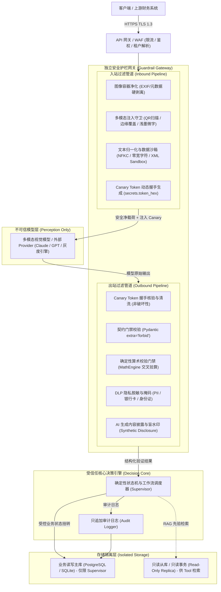
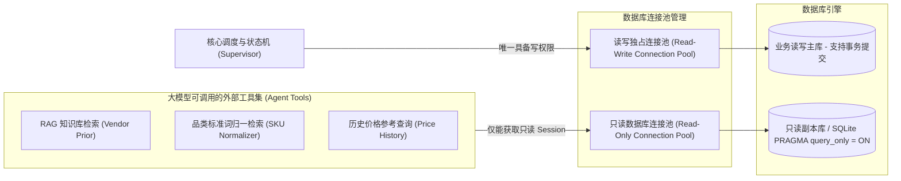

# 独立安全护栏网关架构设计规范 (Guardrail Gateway Architecture Design Spec)

- 文档标识: W-ARCH-2
- 日期: 2026-09-27 (落地实施 2026-09-28)
- 范围: 票据智能体独立安全护栏网关 (Guardrail Gateway) 拓扑、管道过滤、感知-决策分离与数据库只读隔离架构

---

## 1. 架构目标与设计原则

随着系统接入多模态大模型 (VLM) 及外部第三方模型提供商 (Provider)，系统面临提示词注入 (Prompt Injection)、数据篡改、越权工具执行与隐私泄露等多维度安全威胁。本架构旨在建立高内聚、低耦合、零信任的独立安全护栏网关 (Guardrail Gateway)。

### 核心设计原则

1. **零信任感知层 (Zero-Trust Perception)**: 视所有外部输入（票据图像、用户提示、第三方 Provider 输出）为不可信数据源。
2. **感知-决策分离 (Perception-Decision Separation)**: 大模型仅作为“非信任信息提取器”（只读感知），严禁赋予其任何写库、命令执行或业务状态扭转权力；业务状态机与金额校验由确定性代码独占控制。
3. **入站/出站双向拦截 (Bi-directional Pipeline)**: 入站过滤载荷注入与格式炸弹；出站校验契约结构、算术一致性并强行脱敏。
4. **工具只读隔离 (Read-Only Tool Sandboxing)**: 智能体辅助检索工具仅开放只读数据库事务连接，杜绝注入后执行恶意写操作。
5. **故障安全与可观测降级 (Fail-Open / Fail-Closed Observability)**: 威胁阻断必须明确留痕安全日志 (`security_events`)，核心组件异常提供降级保序与降级标记 (`image_guard_degraded`)。

---

## 2. 独立护栏网关整体拓扑与网络拓扑



---

## 3. 入站与出站中间件处理流水线 (Pipeline Spec)

### 3.1 入站管道 (Inbound Pipeline) 处理阶梯

1. **Rate Limiting & Tenant Auth**:
   - 令牌桶限流算法（单租户并发上限 10 QPS，单 IP 30 QPS）。
   - 解析 Authorization 提取 `tenant_id`，注入请求上下文。
2. **Image Sanitizer (图像容器安全重构)**:
   - 绝不信任原始文件二进制结构。
   - 使用 Pillow 解码像素数据，丢弃所有原始 EXIF、ICC Profile、XMP 及文本注释。
   - 创建全新空白 Image 容器，原图像素贴图 (`paste`) 后重新编码保存为纯净 JPEG/PNG，强制设置 `exif=b""`。
3. **Multimodal Injection Guard (多模态载荷检测)**:
   - **QR / 条码有效载荷检测**: `cv2.QRCodeDetector()` 自动定位并解析二维码内容。若二维码包含 `http(s)://`、`javascript:`、`data:` 或提示词指令（`ignore`、`override`），判定为中/高危攻击。纯订单号或流水号则放行。
   - **边缘文字/覆盖层启发式 (Edge Overlay Heuristic)**: 分析图像四周边框区域的暗色连通域，防范攻击者在单据外围贴附隐蔽提示词指令条。
   - **浅墨与微字 (Faint-Ink & Tiny-Text)**: 检测低对比度连通域及细小字符密集区。
   - **多信号仲裁**: 当且仅当 `signals >= 2` 或命中强恶意 QR/覆盖层时触发立即阻断（`status="flagged"`），单信号仅记录警告降级。
4. **Text Normalization & Sandbox Wrapping (文本归一化与沙箱化)**:
   - 统一执行 Unicode NFKC 标准化，剥离零宽字符 (`\u200b`, `\u200c`, `\u200d`, `\ufeff`)。
   - 统一全角/半角、Leet-speak 字符及 HTML 实体转义。
   - 动态沙箱化：所有非受信任的用户提示 (vendor_hint) 与历史先验，统一使用 XML 数据沙箱包裹：
     `<untrusted_input data_only="true" security="untrusted_external_data">...</untrusted_input>`
   - 杜绝闭合标签逃逸攻击（自动转义内部虚假 `</untrusted_input>`）。
5. **Canary Token Generation**:
   - 生成具备 128-bit 随机熵的临时握手令牌：`CANARY_[0-9A-F]{8}`。
   - 注入 System Prompt 与 Human Message，要求模型在顶层 JSON 中必须回传 `__guard_token`。

### 3.2 出站管道 (Outbound Pipeline) 处理阶梯

1. **Canary Token Verification & Non-Destructive Cleansing**:
   - 提取上游响应中的 `__guard_token`，使用常数时间比较算法 (`secrets.compare_digest`) 核验。
   - 若缺失或不匹配：**立即 fail-closed 阻断**，记录 `[SECURITY_ALERT]`。错误提示只包含哈希摘要与长度，严禁回显预期令牌明文。
   - 非破坏性清洗：返回剥除 `__guard_token` 的新副本，入参原始字典保持不变。
2. **Contract Guard (Pydantic Schema Validation)**:
   - 强制启用 `model_config = ConfigDict(extra="forbid")`，拒绝任何未经声明的未授权注入字段。
   - 校验金额、单价、数量必须为有限数值，严禁 `NaN`、`Infinity`、`-Infinity`。
   - 校验日期严格匹配 `YYYY-MM-DD` 规范，单据类型严格限制在枚举白名单内。
3. **Arithmetic Consistency Gate (确定性算术门禁)**:
   - 零 Token 消耗纯 Python 验证：
     - 行级验证: `abs(qty * unit_price - amount) <= 0.05`
     - 整单验证: `abs(sum(items.amount) + fees - discounts - total) <= 0.05`
   - 算术异常不执行整图盲目重识别，进入快速反馈分支 (`gate_reject_fast`)，保留结构化数据并标记 `parsed_with_warnings`，引导人工复核。
4. **DLP Privacy Masking (数据脱敏与掩码)**:
   - 供应商别名化 (`Vendor_A`)。
   - 金额动态掩码（非授权人员展示为 `$***.00`）。
   - 正则自动识别身份证、香港身份证、大陆居民身份证、手机号码及银行卡号，强制星号脱敏。
5. **AI Synthetic Disclosure (合成内容标识)**:
   - 出站 JSON 自动打上深度合成元数据标记。
   - 图片导出接入盲水印渲染。

---

## 4. 智能体工具读写分离与只读数据库隔离架构

为彻底杜绝大模型被越狱后通过智能体工具 (Tools) 篡改业务库数据或注入恶意后门，系统实行严格的物理/逻辑读写隔离：



### 4.1 技术实现细则

1. **连接池硬性隔离**:
   - `get_readonly_db_session()`: 专门分配给所有智能体工具及 RAG 检索器。
     - PostgreSQL 配置: `SET TRANSACTION READ ONLY;` 或连接专属只读账号（仅拥有 `SELECT` 权限，对所有表无 `INSERT/UPDATE/DELETE/ALTER/DROP` 权限）。
     - SQLite 配置: 开启 `PRAGMA query_only = ON;`，底层禁止任何写页操作。
2. **状态机写操作唯一接收入口**:
   - 任何涉及 `receipts` 表状态变更（如 `pending -> parsed -> flagged`）、明细落库及审计日志写入，必须由运行在沙箱外部的 Python 受信控制器 `supervisor` 通过写连接池独占执行。
   - 严禁向大模型暴露任何带有写语义的 Tool 描述（无 `update_receipt`, `delete_vendor` 等工具）。

---

## 5. 感知-决策分离架构 (Perception-Decision Separation)

传统 Agent 架构将“感知（看见什么）”与“决策（该做什么）”混为一谈，导致大模型直接操纵业务流程。本系统严格推行感知-决策解耦：

| 架构分层 | 构成组件 | 信任等级 | 职责与权限范围 | 越界防范机制 |
| :--- | :--- | :--- | :--- | :--- |
| **感知层 (Perception)** | OCR 引擎、VLM、第三方 Provider | **UNTRUSTED (不可信)** | 仅负责将非结构化像素/文本转化为原始候选键值对；无任何执行权限。 | 零网络出站、输入沙箱隔离、输出强契约校验、Canary 校验。 |
| **决策层 (Decision)** | Supervisor、算术引擎、契约门禁、状态机 | **TRUSTED (高度受信)** | 严格由确定性代码实现；执行数学校验、状态流转决策、审计记录与告警调度。 | 纯 Python 代码，不依赖模型概率判断；代码受单测/对抗测试 100% 覆盖。 |
| **执行层 (Execution)** | 数据库写入器、存储客户端、消息通知 | **RESTRICTED (受限受信)** | 执行受控写操作，仅响应决策层发出的确定性指令。 | 幂等性控制、租户隔离拦截器、行级数据权限。 |

---

## 6. 接口演进路线与向后兼容策略 (API Evolution Spec)

为支持未来由进程内嵌入式架构向独立微服务 (Sidecar / Standalone Gateway) 平滑演进，网关定义标准化 RESTful / gRPC 协议契约：

### 6.1 独立网关接口规范 (`/api/v2/guardrail/...`)

- **入站净化与检测接口 (`POST /api/v2/guardrail/inbound/inspect`)**:
  - Request:
    ```json
    {
      "tenant_id": "tenant_1001",
      "image_base64": "...clean_bytes...",
      "hints": ["送货单", "测试供应商"],
      "enable_canary": true
    }
    ```
  - Response:
    ```json
    {
      "pass": true,
      "flagged": false,
      "reasons": [],
      "signals": {"qr_alert": false, "overlay": false, "faint_ink": false},
      "canary_token": "CANARY_A1B2C3D4",
      "sanitized_prompt": [ ... ]
    }
    ```

- **出站校验与脱敏接口 (`POST /api/v2/guardrail/outbound/verify`)**:
  - Request:
    ```json
    {
      "tenant_id": "tenant_1001",
      "expected_canary": "CANARY_A1B2C3D4",
      "raw_model_response": "{ ... }"
    }
    ```
  - Response:
    ```json
    {
      "pass": true,
      "security_blocked": false,
      "math_passed": true,
      "math_problems": [],
      "cleaned_data": { ... },
      "masked_data": { ... },
      "synthetic_disclosure": { ... }
    }
    ```

### 6.2 向后兼容与灰度迁移路径

1. **第一阶段 (当前完成态 - In-Process Modular)**:
   - 护栏组件位于 `ai_registry/tools/` 与 `app/services/`，作为 Python 库直接由应用层同步调用。
   - 共享内存，零网络开销，延迟增加 `< 15ms`。
2. **第二阶段 (Sidecar 容器代理模式)**:
   - 提取网关核心为独立轻量服务，与主业务 Pod 以 Sidecar 形式同机部署，通过 Localhost HTTP/Unix Domain Socket 通信。
   - 业务逻辑与安全逻辑物理代码库解耦，支持安全规则热更新与独立灰度。
3. **第三阶段 (集中式独立 API 安全网关集群)**:
   - 部署为企业级独立 API 网关集群，承载多系统、多业务线的 AI 交互流量统一风控与合规审计。
